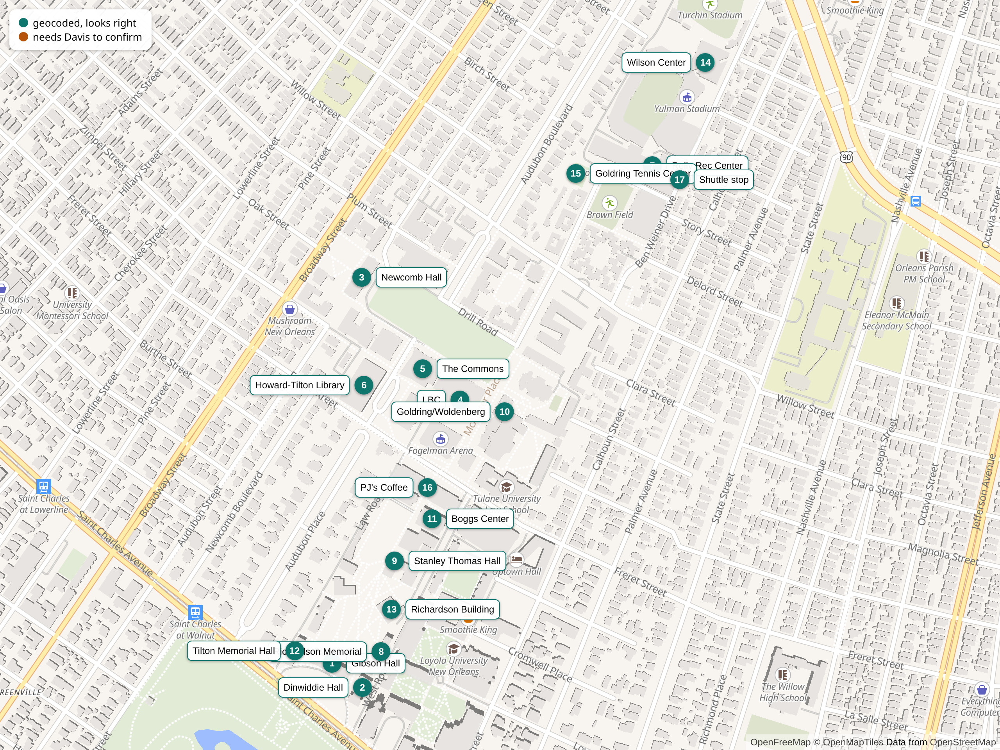

# Places check

Generated by `make places-check` on 2026-11-11. Pins numbered as in `places-check.png`. Teal pins were geocoded cleanly; amber pins need Davis to confirm or move them. Corrections go straight into `src/gw/data/places.json` (set `verified: true`, `source: "Davis"`), then run `make geodata ONLY=walking`.

| # | Place | Lat, lng | Source | Verified | Matched |
|---|---|---|---|---|---|
| 1 | Gibson Hall | 29.935403, -90.122753 | Nominatim | yes | Gibson Hall, 6823, Saint Charles Avenue, Black Pearl, Greenv |
| 2 | Dinwiddie Hall | 29.935005, -90.122182 | Nominatim | yes | Dinwiddie Hall, West Road, Black Pearl, Greenville, New Orle |
| 3 | Newcomb Hall | 29.941705, -90.122188 | Nominatim | yes | Newcomb Hall, 1229, Broadway Street, Black Pearl, Greenville |
| 4 | LBC | 29.939710, -90.120332 | Nominatim | yes | Lavin-Bernick University Center (LBC), McAlister Place, Upto |
| 5 | The Commons | 29.940212, -90.121035 | Davis | yes | Malkin-Sacks Commons (dining); confirmed by Davis |
| 6 | Howard-Tilton Library | 29.939949, -90.122148 | Nominatim | yes | Howard Tilton Memorial Library, Freret Street, Uptown Histor |
| 7 | Reily Rec Center | 29.943537, -90.116715 | Nominatim | yes | Reily Student Recreation Center, Janet Yullman Way, Greenvil |
| 8 | Richardson Memorial | 29.935596, -90.121815 | Nominatim | yes | Richardson Memorial Hall, West Road, Black Pearl, Greenville |
| 9 | Stanley Thomas Hall | 29.937069, -90.121574 | Nominatim | yes | Stanley Thomas Hall, Engineering Road, Black Pearl, Greenvil |
| 10 | Goldring/Woldenberg | 29.939511, -90.119495 | Nominatim | yes | Goldring/Woldenberg Hall II, McAlister Place, Uptown Histori |
| 11 | Boggs Center | 29.937760, -90.120860 | Nominatim | yes | Boggs Center for Energy and Biotechnology, Engineering Road, |
| 12 | Tilton Memorial Hall | 29.935611, -90.123451 | Nominatim | yes | Tilton Memorial Hall, Law Road, Black Pearl, Greenville, New |
| 13 | Richardson Building | 29.936288, -90.121625 | Davis | yes | Richardson Building, Engineering Road, Black Pearl, Greenvil |
| 14 | Wilson Center | 29.945220, -90.115714 | Nominatim | yes | Wilson Athletic Center, 111, Ben Weiner Drive, Broadmoor, Ne |
| 15 | Goldring Tennis Center | 29.943410, -90.118158 | Davis | yes | Tennis courts beside Reily / Brown Field (OSM way 1531679850 |
| 16 | PJ's Coffee | 29.938275, -90.120957 | Davis | yes | PJ's Coffee and Tea [osm node/583450123]; confirmed by Davis |
| 17 | Shuttle stop | 29.943300, -90.116200 | Davis | yes | Ben Weiner Drive, out front of the Reily Center (per Davis) |
